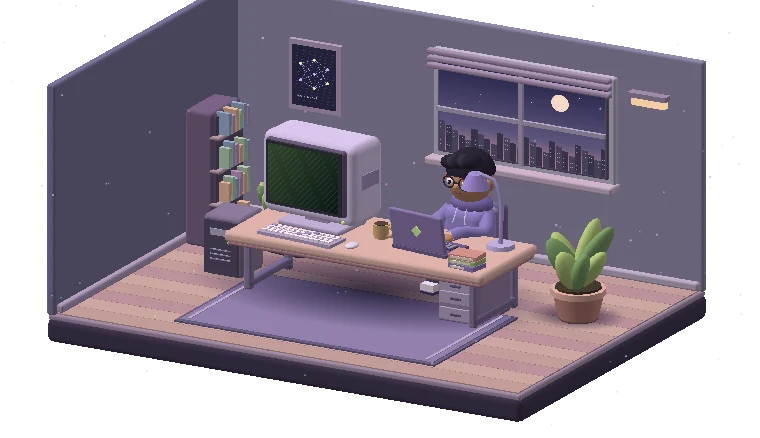

# Prashant Sharma · Interactive Portfolio

I'm an AI and ML undergraduate at Madhav Institute of Technology & Science, Gwalior. My portfolio lives inside a retro computer. Power on the CRT to explore my work in evidence-backed research, document retrieval, energy forecasting, and railway field reporting.

[**Enter the workspace**](https://prashant-7-8-7.github.io/prashant-portfolio/) · [Open the desktop](https://prashant-7-8-7.github.io/prashant-portfolio/#desktop) · [Browse the projects](https://prashant-7-8-7.github.io/prashant-portfolio/portfolio/#work)

<p align="center">
  
</p>

## Explore the workspace

Choose **Enter workspace**, then click the monitor or select **Open computer**. The CRT runs a short startup sequence and opens **My Showcase**. Drag a window by its title bar to move it, or drag its lower-right corner to resize it. Use **Look around** to return to the room while your desktop stays open.

| Where | What to try |
| --- | --- |
| **My Showcase → Projects** | Read the case studies, including what I built, how I tested it, and where to find the source. |
| **Start → Claim verifier** | Compare three sample claims against GridPulse's documented rules. The demo shows why each claim is supported, contradicted, or lacks evidence. |
| **Start → Terminal** | Type `help` for commands, or run `open research` to launch a case study. |
| **Start → Games** | Play Signal Sweeper, Word Guess, Word Tiles, Field Expedition, or Server Room Escape. |
| **Start → Radio** | Play *Night Shift* or *First Light*. Use **Hear greeting** in the room to replay the introduction. |

**Expand screen** gives the desktop more room and opens by default on phones. **Pause motion** and **Sound on/off** control the experience. The room also respects your device's reduced-motion setting.

## Featured projects

| Project | What it does | Source |
| --- | --- | --- |
| **Research Agents** | Produces cited research reports and checks individual claims against source text. | [GitHub](https://github.com/prashant-7-8-7/research-agents) |
| **GridPulse** | Forecasts electricity demand from hourly weather data and applies dispatch and overload rules for a microgrid. | [GitHub](https://github.com/prashant-7-8-7/GridPulse) |
| **AI Document Workspace** | Helps students study uploaded documents through source-linked answers, a document viewer, and quizzes. | [GitHub](https://github.com/prashant-7-8-7/Macro-Project-) |
| **RailSetu** | Supports railway maintenance planning and field reporting. I tested and debugged the Flutter reporting flow and its FastAPI integration. | [Team repository](https://github.com/ssh-gaurav/RailSetu) |

## Run locally

Use **Node.js 24**, the same major version used by the deployment workflow.

```bash
git clone https://github.com/prashant-7-8-7/prashant-portfolio.git
cd prashant-portfolio
npm ci
npm run dev
```

Open the URL printed in the terminal. To check the production build locally, use these commands.

```bash
npm run build
npm run preview
```

The build outputs static files to `dist/`. The **Deploy portfolio** workflow publishes them to GitHub Pages on pushes to `main` and supports manual runs. [Deployment workflow](.github/workflows/pages.yml)

## How it works

The portfolio runs in the browser. The room uses Three.js and WebGL 2, with a software Canvas renderer as a fallback. The scene projects a working HTML desktop onto the CRT. The Web Audio API generates sound effects, and the narration and music are bundled locally. Vite builds the site and its standalone Showcase.

| Source | What to edit |
| --- | --- |
| [`src/room-models.js`](src/room-models.js) and [`src/room-scene.js`](src/room-scene.js) | Room geometry, camera movement, and CRT projection |
| [`src/laptop.js`](src/laptop.js) and [`src/desktop-windows.js`](src/desktop-windows.js) | Greeting, boot sequence, and window controls |
| [`src/desktop-apps.js`](src/desktop-apps.js) and [`src/desktop-games.js`](src/desktop-games.js) | Desktop apps, terminal commands, and games |
| [`portfolio/index.html`](portfolio/index.html) and [`src/projects.js`](src/projects.js) | Showcase content, case studies, and verifier examples |
| [`src/workspace-audio.js`](src/workspace-audio.js) and [`public/sound/`](public/sound/) | Sound effects, greeting, and radio tracks |

## Credits

- The animated character and workbench draw inspiration from [David Heckhoff](https://david-hckh.com/).
- The CRT, camera transitions, and desktop draw inspiration from [Henry Heffernan's workspace](https://henryheffernan.com/) and [desktop](https://os.henryheffernan.com/).
- The room models, sound effects, radio tracks, and games were made for this portfolio. The greeting uses a synthetic Flite voice.
- The GridPulse image comes from the [project's dashboard screenshot](https://github.com/prashant-7-8-7/GridPulse/blob/main/docs/assets/dashboard.jpg).

## Contact

[GitHub](https://github.com/prashant-7-8-7) · [LinkedIn](https://in.linkedin.com/in/prashant-sharma-040ab0388)
